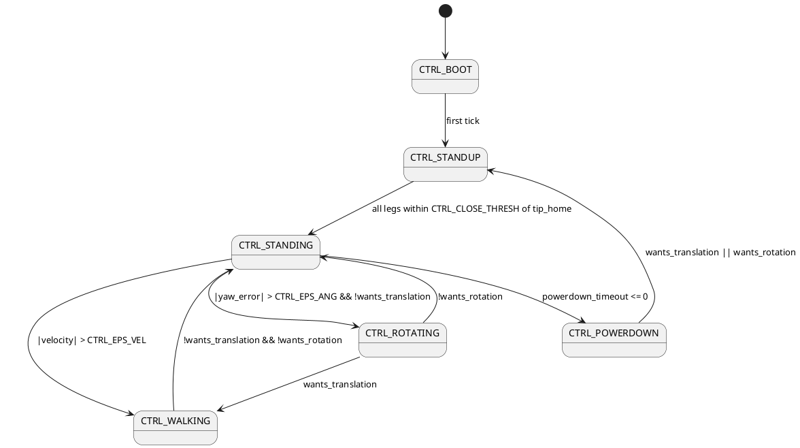
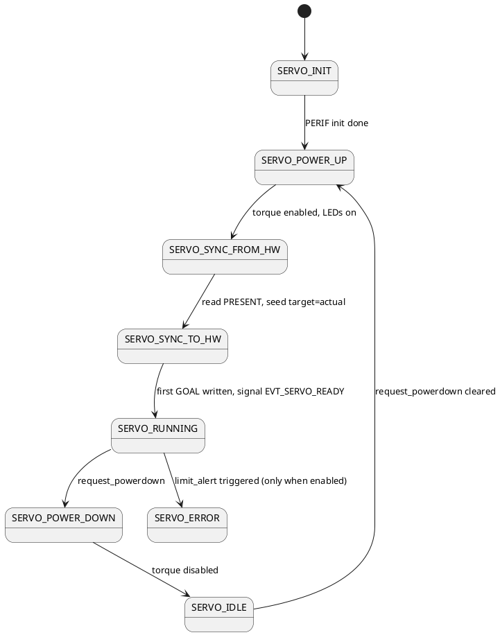
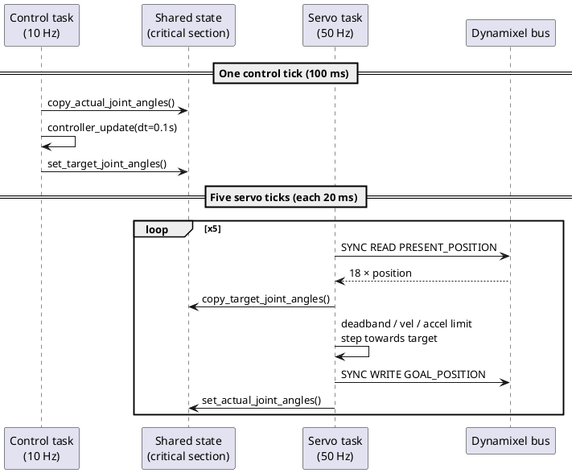

# Hexapod Controller Overview

This document describes the motion controller implemented in
[`Core/Src/controller.c`](../Core/Src/controller.c) and how it integrates with the
servo task in [`Core/Src/main.c`](../Core/Src/main.c). It is the as-built
companion to the design intent captured in [`control-model.md`](control-model.md).

The controller is a discrete-time state machine that takes a high-level
locomotion command (`velocity`, `heading`, `height`) and produces target joint
angles for the 18 Dynamixel XL430 servos. It runs at 10 Hz; the servo task
runs at 50 Hz and is responsible for interpolating, rate-limiting and pushing
commands to the bus.

---

## 1. Architecture

```
                    ┌───────────────────────────────┐
                    │  External command source      │
                    │  (SPI, joystick, scripted)    │
                    │                               │
                    │  updated_velocity             │
                    │  updated_heading              │
                    │  updated_height               │
                    └──────────────┬────────────────┘
                                   │ 10 Hz snapshot
                                   ▼
   ┌────────────────────────────────────────────────────────────┐
   │  CONTROL TASK  (StartControlTask, 10 Hz)                   │
   │                                                            │
   │  1. snapshot servo_shared_state.actual_joint_angles        │
   │  2. controller_update(ctx, attitude, cmd, dt_s)            │
   │     - state machine (BOOT → STANDUP → STANDING → ...)      │
   │     - gait + path planning per leg                         │
   │     - inverse kinematics → next_joint_angles               │
   │  3. publish next_joint_angles as                           │
   │     servo_shared_state.target_joint_angles                 │
   └──────────────────────────┬─────────────────────────────────┘
                              │ shared, critical-section guarded
                              ▼
   ┌────────────────────────────────────────────────────────────┐
   │  SERVO TASK  (StartServoTask, 50 Hz)                       │
   │                                                            │
   │  1. read PRESENT_POSITION (bulk read, all 18 servos)       │
   │  2. snapshot target_joint_angles                           │
   │  3. error → step (deadband + velocity + accel limits)      │
   │  4. uncompensate + convert to pulses                       │
   │  5. write GOAL_POSITION (bulk write)                       │
   │  6. publish actual_joint_angles to shared state            │
   └──────────────────────────┬─────────────────────────────────┘
                              │ half-duplex UART + DMA
                              ▼
                   Dynamixel XL430 servo bus
```

Two FreeRTOS tasks, one shared state struct, one mutex-free critical-section
discipline. The controller never talks to the servos directly — it only
publishes intent, and trusts the servo task to follow it within the configured
velocity / acceleration envelope.

### Loop rates and `dt_s`

| Loop          | Macro                                              | Rate     | Period |
|---------------|----------------------------------------------------|----------|--------|
| Control       | `CONTROL_LOOP_INTERVAL = HZ_TO_INTERVAL(10)`       | 10 Hz    | 100 ms |
| Servo         | `SERVO_LOOP_INTERVAL = HZ_TO_INTERVAL(50)`         | 50 Hz    |  20 ms |

Both tasks measure their own `dt_s` from `osKernelGetTickCount()` and clamp it
to a band around the nominal tick (control task `[0.05, 0.2] s`, servo task `[0.01, 0.04] s`) to ride out scheduler hiccups without producing wild
single-tick deltas.

---

## 2. State, frames and data

### Coordinate frames

```
   world ─┐
          │  Thexapod = pose_get_transformation(ctx->robot.hexapod)
          ▼
   body  ─┐
          │  Tbody    = pose_get_transformation(ctx->robot.body)
          ▼
   hexapod_body = Thexapod · Tbody     (body pose in world)
          │
          │  coxa_mat[i] = mount_point in body frame
          ▼
   coxa[i] ─── forward_kinematics(q) ─► tip in coxa frame
```

- **World frame** — fixed inertial frame. `ctx->robot.hexapod.translation` and
  `.rotation[2]` (yaw) are integrated here as the robot moves.
- **Body frame** — attached to the body. `ctx->robot.body` holds a fixed
  `(0, 0, height, 0, 0, 0)` pose; only the Z is mutated to match the commanded
  `height`.
- **Coxa frame** — attached to each leg's mount point. `coxa_mat` and its
  inverse `coxa_mat_inv` are precomputed once in `controller_init` from the
  leg's `mount_point_polar`. All inverse / forward kinematics happen in this
  frame.

### `controller_ctx_t`

Held by the control task on its stack. Key fields (see
[`Core/Inc/controller_types.h`](../Core/Inc/controller_types.h)):

| Field                 | Meaning                                                      |
|-----------------------|--------------------------------------------------------------|
| `state`, `next_state` | Current and pending FSM states                               |
| `powerdown_timeout`   | Seconds of inactivity remaining before auto-powerdown        |
| `yaw_error`           | `wrap_to_pi(heading - yaw)`, used by WALKING and ROTATING    |
| `robot.hexapod`       | World-frame pose of the body                                 |
| `robot.body`          | Fixed body-relative pose, only Z (height) is dynamic         |
| `robot.leg_state[6]`  | Per-leg kinematic state and gait phase                       |
| `on_state_change`     | Callback into `main.c` for LED + servo-flag side effects     |

### `leg_state` (per leg)

| Field                    | Meaning                                                |
|--------------------------|--------------------------------------------------------|
| `coxa_mat`, `coxa_mat_inv` | Body↔coxa transform, precomputed at init             |
| `tip_home`               | Foot home position in body frame (Z=0 initially)      |
| `actual_joint_angles`    | Last value mirrored from servo task                    |
| `next_joint_angles`      | Output, published to the servo task                    |
| `tip_world_coordinates`  | Foot tip in world frame (used to keep grounded feet planted) |
| `grounded`               | 1 = stance leg, 0 = swing leg                          |

### Robot configuration

The six legs are defined in [`Core/Inc/robot_config.h`](../Core/Inc/robot_config.h)
as a `const struct robot r`. Mount points are polar, with the convention
`(radius_mm, angle_rad)` measured from the body centre. Servo IDs are listed
Coxa-Femur-Tibia and the per-joint min/max limits enforce mechanical reach.

---

## 3. State machine



Transitions are evaluated near the top of every `controller_update`, before
the body of the state runs. The transitions:

1. **`CTRL_BOOT`** — entered at init; unconditionally goes to `CTRL_STANDUP`
   on the first tick.
2. **`CTRL_STANDUP`** — drives every foot from its current location (snapshot
   of `next_joint_angles`, *not* `actual_joint_angles`, to keep the trajectory
   continuous) towards `tip_home` at `−CTRL_BODY_Z`. Uses
   `calculate_motion_step` with `(vel=50 mm/s, lift_vel=20 mm/s, lift=50 mm)`.
   Transitions to `CTRL_STANDING` once every leg is within
   `CTRL_CLOSE_THRESH = 3 mm` of its target.
3. **`CTRL_STANDING`** — no leg motion. A 120 s `powerdown_timeout` counts
   down here; any other state resets it. Branches to `WALKING` or `ROTATING`
   based on whether the user wants translation, rotation, or both.
4. **`CTRL_WALKING`** — see §4.2. Handles translation + optional yaw.
5. **`CTRL_ROTATING`** — see §4.3. Pure in-place yaw with a tripod gait.
6. **`CTRL_POWERDOWN`** — torque is disabled on every servo via the
   `stm32_state_change_cb` callback in [`Core/Src/main.c`](../Core/Src/main.c).
   Wakes back up into `STANDUP` on any user command.

The callback (`controller_set_state_callback`) is invoked exactly once per
transition, immediately after `state` is updated and before the new state's
body runs. `main.c` uses it to drive the RGB LED, toggle
`servo_set_request_powerdown`, and enable/disable joint-limit alerts during
WALKING/ROTATING.

---

## 4. The math

### 4.1 Common preliminaries

Each tick:

```
Thexapod      = pose_get_transformation(robot.hexapod)        // world ← body
Tbody         = pose_get_transformation(robot.body)           // body  ← body offset (height)
Thexapod_body = Thexapod · Tbody                              // world ← body shifted
```

User commands map to:

- `velocity` — forward speed in mm/s. The math is sign-agnostic, but the SPI
  command handler rejects values outside 0–100 (`main.c`), so walking backward is
  not reachable in practice.
- `heading` — desired absolute yaw in world frame; `yaw_error = wrap_to_pi(heading − yaw)`.
- `height` — desired body Z. Only mirrored into `robot.body.translation[2]`
  while in `STANDING` or `WALKING`.

`wrap_to_pi` lives in [`Core/Inc/controller_math.h`](../Core/Inc/controller_math.h:16):

$$ \mathrm{wrap}(\theta) = ((\theta + \pi) \bmod 2\pi) - \pi \;\;\in\;\; (-\pi, \pi] $$

### 4.2 WALKING

Per tick, with timestep $\Delta t = $ `dt_s`:

**Step 1 – yaw rate.** A simple proportional servo on yaw error, clamped:

$$
\omega = \mathrm{clamp}\!\left(\frac{\Delta\psi}{\Delta t},\; -\omega_{\max},\; +\omega_{\max}\right),\quad
\Delta\psi_{\text{step}} = \omega \cdot \Delta t
$$

with $\omega_{\max} = $ `CTRL_MAX_YAW_RATE` $ = 0.1$ rad/s.

**Step 2 – translation in body frame.** The commanded `velocity` is in the
robot's heading direction. We build it in world frame, then rotate back into
body frame:

$$
\mathbf{v}_{\text{world}} = v \begin{bmatrix}\cos\psi \\ \sin\psi\end{bmatrix},\qquad
\mathbf{v}_{\text{body}} = R(-\psi)\,\mathbf{v}_{\text{world}}
$$

Per-tick translation in body frame: $\mathbf{m} = \mathbf{v}_{\text{body}}\Delta t$.

**Step 3 – integrate world pose.** Translation is converted to world frame
using the *mid-tick* yaw to reduce drift on curved paths:

$$
\psi_{\text{mid}} = \psi + \tfrac12 \Delta\psi_{\text{step}},\qquad
\begin{bmatrix}\Delta x \\ \Delta y\end{bmatrix}_{\text{world}} = R(\psi_{\text{mid}})\,\mathbf{m}
$$

`robot.hexapod.translation += [Δx, Δy]` and `robot.hexapod.rotation[2] += Δψ`.

**Step 4 – per-leg path planning.** For each leg, with current foot in body
frame $\mathbf{r}$ (from forward kinematics through `coxa_mat`):

1. Compute the rotation displacement for this foot, $\mathbf{r}_\perp = (-r_y, r_x)$
   ($= \hat{z} \times \mathbf{r}$), scaled by the yaw step:

   $$ \mathbf{d}_{\text{rot}} = \mathbf{r}_\perp \cdot \Delta\psi_{\text{step}} $$

   Clamped per-foot to `CTRL_MAX_ROT_FOOT_MM = 6 mm`.

2. Combine with translation. Grounded (stance) legs move opposite to body
   motion to stay planted; swing legs move with it to reach the next stance:

   $$
   \mathbf{a}_{\text{stance}} = -\mathbf{m} + \mathbf{d}_{\text{rot}},\quad
   \mathbf{a}_{\text{swing}}  = +\mathbf{m} + \mathbf{d}_{\text{rot}}
   $$

3. Project onto the step circle around `tip_home`:

   $$ \mathbf{p}_{\text{target}} = \mathbf{origin} + R_{\text{step}} \cdot \widehat{\mathbf{a}} $$

   with $R_{\text{step}} = $ `CTRL_LEG_RADIUS_MM` $= 40$ mm (see
   `project_point_on_circle` in `hexapodmath`).

4. Build a 4-point path from `p_current` to `p_target` via `calculate_path`
   (stance legs use a straight line; swing legs use a lift profile — see §5).

**Step 5 – tracking speed.** A common "longest path" is taken across the
group, an effective velocity is built from the commanded translation
magnitude plus a rotational component proportional to the body radius, and
each path is sampled with `interpolate(path, step_length, delta)` to get the
foot's next body-frame target. World-frame coordinates of grounded feet are
preserved (`tip_world_coordinates`) so floating-point drift doesn't cause
slip; swing feet take the new world position.

**Step 6 – IK.** `p_next_world → Tinv · p_next_world → coxa frame →
inverse_kinematics → next_joint_angles`.

**Step 7 – tripod swap.** When the longest swing path has shrunk under
`CTRL_CLOSE_THRESH`, the stance/swing assignment is flipped (`swap_legs`).

### 4.3 ROTATING

Same skeleton as WALKING, with translation forced to zero. The simplification:

- No `v_world` / `v_body` step.
- `arc_disp` for both stance and swing comes only from $\mathbf{d}_{\text{rot}}$
  (negated for stance legs, positive for swing).
- Tracking velocity uses a fixed `distance_per_tick = CTRL_DEFAULT_VEL · dt_s`
  rather than the combined linear+angular estimate.
- The body's world translation is *not* updated, only its yaw.

### 4.4 STANDUP

Per leg, target is body-frame `(tip_home_x, tip_home_y, -CTRL_BODY_Z)`. The
current position is read from the *last commanded* `next_joint_angles` (not
the servo's actual angles), so the trajectory the servo task is tracking
stays C⁰-continuous across state transitions. `calculate_motion_step` in
[`Core/Src/calculator.c`](../Core/Src/calculator.c) handles the lift/lower
profile with these properties:

- Horizontal speed limited to `motion->velocity`.
- Vertical speed limited to `motion->lift_velocity`.
- Lift height auto-shrinks when remaining travel is too short to fit a full
  lift + lower (otherwise the foot would never touch back down before
  reaching the XY target).

Done when every leg is within `CTRL_CLOSE_THRESH` of its target; at that
point `body.translation[2]` is committed to `CTRL_BODY_Z` and all legs are
marked `grounded`.

### 4.5 Tripod gait initialization

On entry to WALKING or ROTATING, `tripod_init_gait` checks whether *all*
legs are currently grounded. If so, it lifts the alternating tripod (legs
1, 3, 5) and refreshes each leg's `tip_world_coordinates` from
`forward_kinematics(actual_joint_angles)` — fixing the world-frame anchor
that grounded legs use to stay planted. If a tripod is already split this is
a no-op, so the gait phase carries cleanly across mode switches (e.g.
WALKING → ROTATING → WALKING).

### 4.6 Configuration constants

From [`Core/Inc/controller_config.h`](../Core/Inc/controller_config.h):

| Name                    | Value     | Meaning                                                       |
|-------------------------|-----------|---------------------------------------------------------------|
| `CTRL_CLOSE_THRESH`     | 3.0 mm    | Distance threshold for "arrived" decisions                    |
| `CTRL_MAX_YAW_RATE`     | 0.1 rad/s | Per-tick yaw rate clamp                                       |
| `CTRL_LEG_RADIUS_MM`    | 40 mm     | Step radius around `tip_home`                                 |
| `CTRL_EPS_VEL`          | 1e-3      | Velocity deadband                                             |
| `CTRL_EPS_ANG`          | 1e-3      | Yaw-error deadband                                            |
| `CTRL_POWERDOWN_TIMEOUT`| 120 s     | Idle timeout before torque-off                                |
| `CTRL_DEFAULT_VEL`      | 50 mm/s   | Standup / rotation tracking speed                             |
| `CTRL_LIFT_VEL`         | 20 mm/s   | Standup vertical speed                                        |
| `CTRL_LIFT_Z`           | 50 mm     | Standup lift height                                           |
| `CTRL_BODY_Z`           | 100 mm    | Default body height after STANDUP                             |
| `CTRL_MAX_ROT_FOOT_MM`  | 6 mm      | Per-tick rotational foot displacement clamp                   |

---

## 5. Path generation

`leg_generate_path` in [`Core/Src/controller.c`](../Core/Src/controller.c:140)
returns a 4-point path in body frame and the Euclidean distance from start to
end. The four points are always:

```
path[0] = p_current
path[1] = lift / no-op
path[2] = pre-lower / no-op
path[3] = p_target  (target.z = -body_z, i.e. on the ground)
```

For **stance legs** (`with_lift = false`), the path is degenerate:
`path[0..2] = p_current`, `path[3] = p_target`. The interpolation along this
path is therefore a straight line.

For **swing legs** (`with_lift = true`), `calculate_path` builds a trapezoid
in the vertical plane along the XY travel direction:

```
       path[1] ─────────── path[2]     (lifted plateau at z + lift_height)
       /                        \
      /                          \
 path[0]                        path[3]
   (p_current)                  (p_target)
```

The lift / lower XY distance is `|missing_height| / lift_incline_factor`. If
total travel is shorter than `lift + lower`, the lift height is scaled down
(`step_height = total_distance_xy · lift_incline_factor`) so the profile
still closes on `p_target`.

`interpolate(path, step_size, next)` walks the segments and returns the point
at arc-length `step_size` along the polyline. `calculate_path_length` is the
sum of the three segment lengths. The substepping done in the controller
(`substeps = longest_path / effective_velocity`, `step_length = path_length /
substeps`) is what ties one leg's progress to the slowest leg in the tripod —
all legs in a phase complete together.

---

## 6. Integration with the servo task

### 6.1 Shared state

[`Core/Inc/servos.h`](../Core/Inc/servos.h:15):

```c
typedef struct {
    float32_t actual_joint_angles[6][3];
    float32_t target_joint_angles[6][3];
    bool initialized;
    bool request_powerdown;
    bool limit_alert_enabled;
} servo_shared_state_t;
```

The single instance `servo_shared_state` (`main.c:318`) is touched by both
tasks. All accesses go through the helpers in
[`Core/Src/servos.c`](../Core/Src/servos.c) which wrap reads / writes in
`taskENTER_CRITICAL()` / `taskEXIT_CRITICAL()`. This is the convention
required by [`CLAUDE.md`](../CLAUDE.md): never read or write `servo_shared_state`
directly, always snapshot via a helper.

### 6.2 Control-task half of the dance

```c
servo_copy_actual_joint_angles(actual_joint_angles, &servo_shared_state);
// ... mirror into leg_state[i].actual_joint_angles ...
controller_update(&controller_ctx, &attitude, &cmd, dt_s);
// ... copy leg_state[i].next_joint_angles out ...
servo_set_target_joint_angles(&servo_shared_state, target_joint_angles);
```

(`main.c:2384–2403`). The controller therefore sees a coherent snapshot of
the actual joint angles, runs the math, and publishes a coherent snapshot of
the new targets. Snapshot-then-compute-then-publish keeps the math reasoning
single-threaded even though both halves run concurrently.

### 6.3 Servo-task FSM



`SERVO_SYNC_FROM_HW` is critical for safe boot: it seeds *both*
`actual_joint_angles` and `target_joint_angles` from the current servo
positions, so the first thing the servo task tries to do is "hold still"
rather than jump to some default pose. After that, control hands `STANDUP`
the same `next_joint_angles` it just published, the trajectory remains
continuous, and nothing snaps.

`EVT_SERVO_READY` is the gate the control task waits on at startup
(`main.c:2341–2344`), so `controller_init` only runs once the bus is up and
the targets have been seeded.

### 6.4 Per-cycle servo interpolation

`SERVO_RUNNING` (`main.c:2506–2614`) is where the actual servo tracking
happens:

1. **Read** PRESENT_POSITION for all 18 servos (bulk DMA read). Convert
   pulse → rad, then `compensate(src, dst)` to bring the geometry into the
   joint-frame the controller uses (`dst.femur = -src.femur`,
   `dst.tibia = src.tibia + 0.4363 rad`).
2. **Snapshot** `target_joint_angles` from shared state.
3. **Per-joint step calculation** with three guards:
   - **Deadband.** `|error| < SERVO_DEADBAND_RAD (≈0.11°)` → no step.
   - **Velocity clamp.** `step = clamp(error, ±SERVO_MAX_VELOCITY · dt_s)`,
     `SERVO_MAX_VELOCITY = 8 rad/s`.
   - **Minimum step.** If the clamped step is non-zero but below
     `SERVO_MIN_STEP_RAD ≈ 0.17°`, it is rounded up to that magnitude (with
     the correct sign) — past that threshold the XL430's internal
     quantization would round it to zero and the foot would just stall.
   - **Acceleration clamp.** Per-joint `last_velocity` is kept; the change in
     desired velocity is clamped to `±SERVO_MAX_ACCELERATION · dt_s`
     (40 rad/s²). The actual step is then `vel · dt_s`.
4. **Limit check** (only while WALKING / ROTATING). If
   `commanded_position` is outside `r.leg[i].limits[j]` the task transitions
   to `SERVO_ERROR` and disables torque. `STANDING` / `STANDUP` deliberately
   leave the limit alert off so warm-up motions don't trip it.
5. **Write.** `uncompensate(commanded, dst)`, rad → pulse, bulk GOAL_POSITION
   write.
6. **Publish.** `servo_set_actual_joint_angles(joint_angles)` so the next
   control-task tick reads fresh feedback.

### 6.5 Side channels (state-change callback)

`stm32_state_change_cb` (`main.c:1359–1407`) translates controller transitions
into servo-task signals plus LED state:

| From → To              | Side effect                                                 |
|------------------------|-------------------------------------------------------------|
| `* → POWERDOWN`        | `servo_set_request_powerdown(true)`, LED magenta blink      |
| `POWERDOWN → *`        | `servo_set_request_powerdown(false)`                        |
| `* → STANDUP`          | LED cyan blink                                              |
| `* → STANDING`         | LED green blink                                             |
| `* → WALKING`          | `servo_set_limit_alert_enabled(true)`, LED blue blink       |
| `* → ROTATING`         | `servo_set_limit_alert_enabled(true)`, LED yellow blink     |
| `WALKING / ROTATING → *` | `servo_set_limit_alert_enabled(false)`                    |

The servo task reads these flags via `servo_get_flags` once per cycle and
folds them into its FSM. Note this is a *request*: the servo task chooses
when to act on it (e.g. it will not honor a powerdown while still in
`SERVO_INIT`).

### 6.6 End-to-end timing



The 5:1 ratio gives the servo task headroom to smooth out the larger
per-control-tick steps. With `SERVO_MAX_VELOCITY = 8 rad/s`, a single servo
tick can cross 0.16 rad ≈ 9.2° of joint travel — comfortably more than any
controller step at the configured locomotion speeds.

---

## 7. Where to look next

- **Inverse / forward kinematics** — `hexapodmath/inverse_kinematics.h`,
  `hexapodmath/forward_kinematics.h` (downloaded into
  `cmake-build-debug/_deps/hexapodmath-src/`).
- **Path math** — `hexapodmath/hexapod.h` for
  `project_point_on_circle`, `calculate_path`, `interpolate`,
  `calculate_path_length`.
- **Pose / transform helpers** — `hexapodmath/pose.h`,
  `hexapodmath/matrix_3d.h`.
- **Tunables** — [`Core/Inc/controller_config.h`](../Core/Inc/controller_config.h)
  for controller, top of [`Core/Src/main.c`](../Core/Src/main.c) for servo
  task (lines 110–128).
- **Design intent (pre-implementation)** — [`control-model.md`](control-model.md).
- **Known issues and planned work** — [`controller-audit.md`](controller-audit.md)
  (findings) and [`improvement-backlog.md`](improvement-backlog.md) (actionable list).
- **Servo motion profiles (planned)** — [`servo-velocity-control-phase2.md`](servo-velocity-control-phase2.md).
