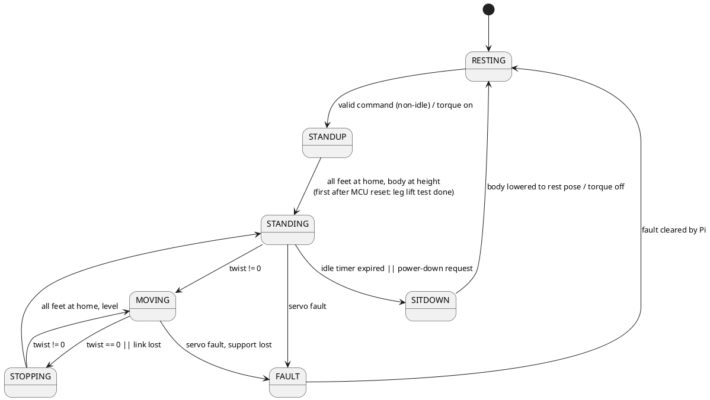

# Hexapod Controller — Design

**Status: DRAFT for review (rev 2).** This restates the original design intent as a
single coherent design and proposes how to get there from the current code.
Decisions D1, D2, D3, D5, D6, D7 and D8 are accepted; D4 has a recommendation
backed by Appendix A. Decisions are collected in §11. Once approved it replaces [`control-model.md`](control-model.md).

Related: [`controller-overview.md`](controller-overview.md) (as built),
[`controller-audit.md`](controller-audit.md) (known problems),
[`improvement-backlog.md`](improvement-backlog.md) (work items).

---

## 1. Requirements

| ID | Requirement |
|----|-------------|
| R1 | Move at a variable speed. |
| R2 | Rotate with a variable rotation rate, including rotation in place. |
| R3 | Strafe in any direction. |
| R4 | Walk with a tripod gait; a ripple gait may be added later without redesign. |
| R5 | Control input arrives over SPI from a Raspberry Pi. |
| R6 | Calculations use four frames: world, body, level, hip. |
| R7 | With no control input the hexapod returns to a standing pose and, after a while, powers down the servos to conserve battery. |
| R8 | Ground contact is determined from servo load, falling back to "tip world Z = 0" when load is unavailable. |

**Does it hang together?** Yes. The requirements are consistent and describe
one machine. Five things only become clear once they are written down, and the
design below takes a position on each:

1. **R1–R3 are one input, not three.** Variable speed, rotation rate, in-place
   rotation and strafing in any direction are all the same thing: a *body
   twist* `(vx, vy, ωz)`. In-place rotation is `vx = vy = 0`; an arc is
   `vx ≠ 0, ωz ≠ 0`; strafing is any `(vx, vy)`. This replaces today's
   `(velocity, absolute heading)` input and removes the separate ROTATING
   state. The old "arc mode vs. strafe mode" joystick toggle becomes a
   Raspberry-Pi-side mapping concern and disappears from the firmware.
2. **R4 needs a gait abstraction.** Today's controller is a two-phase,
   event-driven tripod: swap when the swing legs arrive. That cannot express a
   ripple gait (six phases, different duty factor). Gait must become data
   (phase offsets and duty factor) plus one scheduler.
3. **R7's "powers down" must not drop the robot.** Today POWERDOWN disables
   torque from the standing pose and the legs flop. The design adds a
   controlled lowering to a rest pose before torque is removed.
4. **R8 changes what a swing leg does.** With real contact sensing a swing leg
   can *end* on contact instead of on a computed trajectory, which makes swing
   duration non-deterministic. The gait scheduler has to be built for that.
   Servo load is also not a force sensor (§7.1), and the 10 Hz control loop is
   too slow to act on it.
5. **R5 implies link supervision.** "No control input" must be detected. Today
   it cannot be: the last command stays in force if the Pi stops talking.

---

## 2. System context

```
 ┌───────────────┐   SPI (Pi = master)   ┌──────────────────────────────────┐
 │ Raspberry Pi  │ ────────────────────► │ STM32F401                         │
 │ joystick,     │   command frame       │  SPI task ─► command (shared)    │
 │ modes, high-  │ ◄──────────────────── │  Control task (planner)          │
 │ level logic   │   status frame        │  Servo task  (tracker, contact)  │
 └───────────────┘                       │  EKF task    (attitude)          │
                                         └─────────────┬────────────────────┘
                                                       │ half-duplex UART DMA
                                                18 × Dynamixel XL430
```

Division of responsibility:

- **Raspberry Pi:** interprets the human (joystick, mode buttons), produces
  a twist, body-pose and gait requests, and supervises the robot via status.
  It knows nothing about legs.
- **Control task (STM32):** gait, foot placement, body pose, inverse
  kinematics. Plans; never touches the bus.
- **Servo task (STM32):** owns the bus. Tracks targets, reads position and
  load, and detects contact (it owns the sensor and runs faster).
- **EKF task:** attitude (roll, pitch, yaw) feeding the level frame.

---

## 3. Command interface (R1–R3, R5)

### 3.1 Command content

The Pi sends a complete command, never single parameters:

| Field | Meaning | Frame / unit |
|-------|---------|--------------|
| `vx, vy` | Commanded translation velocity | level frame, mm/s |
| `wz` | Commanded yaw rate | rad/s, + = counter-clockwise |
| `height` | Body height above ground | mm |
| `tilt` *(optional)* | Commanded body roll/pitch offset | rad |
| `gait` | Gait id (tripod now, ripple later) | enum |
| `flags` | Stop, power-down request, fault clear | bits |

Speed and direction are `|v|` and `atan2(vy, vx)`; there is no separate heading
or mode. The controller clamps `v` and `wz` to configured maxima and applies
the slew limit (§5.4); the Pi may send raw joystick-scaled values.

**D1 — absolute heading (accepted).** Today the Pi sends an absolute world heading and
the robot turns toward it. A rate command is simpler and matches R2, but loses
"face this compass direction". Decision: rate only; the Pi closes any heading
loop itself using the yaw it reads back in status.

### 3.2 Frame format

Today: 7-byte frames, magic `0xA5`, one parameter each, no checksum, no
sequence, no reply. Proposed single fixed-size frame (field layout is a
proposal, not final):

```
magic(1) | version(1) | seq(1) | flags(1) | vx f32 | vy f32 | wz f32 |
height f32 | tilt_r f32 | tilt_p f32 | gait(1) | crc16(2)
```

SPI is full duplex and the STM32 is the slave, so every command transfer also
clocks out a **status frame**. The reply content is fixed one transfer ahead,
so status lags by one frame; fine at the command rate.

**Telemetry (D7, accepted).** Path planning, navigation and other higher
functions stay on the Raspberry Pi; the controller is the low-level layer that
turns a twist into a gait. The Pi will therefore eventually need the full
picture, so the status frame carries a version byte and a length and grows in
steps:

| Version | Content |
|---------|---------|
| v1 (first implementation) | State, fault code, per-leg contact bits, estimated yaw |
| later | Odometry pose from stance feet (x, y, yaw; §5.5), roll and pitch, achieved twist, battery voltage, servo temperatures and voltages, bus health counters (backlog T7.12) |

The Pi has to ignore fields it does not know, and the controller must not
depend on the Pi using any of them. Everything beyond v1 is added when the Pi
side needs it, not before.

### 3.3 Link supervision

| Condition | Behavior |
|-----------|----------|
| Valid frame with new `seq` | Command applied; `last_cmd_time` updated. |
| CRC/magic error | Frame dropped; counts as no input. |
| No valid frame for `T_LINK` (proposal 300 ms) | Twist forced to zero; robot decelerates, stops and ends in STANDING (§8). |
| Zero twist from a live link | Same behavior: stop and stand. |

There is no separate behavior for a dead link (D5, accepted): losing the link
makes the robot stop and stand, and from there the idle timer (§8.3) decides
when it sits down, exactly as for a live link that sends zero twist.

The Pi must send at ≥ 10 Hz (matches the control tick); 20–50 Hz recommended.

---

## 4. Frames (R6)

Four frames, one chain: **world ← level ← body**, and **body ← hip** per leg.

| Frame | Origin | Orientation | Changes with | Defined by |
|-------|--------|-------------|--------------|------------|
| **World** | Fixed point on the ground where the robot stood up; `Z = 0` is the ground plane | Gravity-aligned, X fixed at standup | Never | Odometry (integration from stance feet) |
| **Level** | Body centre (same point as the body frame) | **Yaw of the body, roll = pitch = 0** (gravity-aligned) | Body position and yaw | World pose of the body + IMU yaw |
| **Body** | Body centre | Fixed to the chassis (tilts and rolls with it) | Body attitude | Level → body = IMU roll/pitch (+ commanded tilt) |
| **Hip** (one per leg) | Coxa axis of that leg | Fixed to the chassis, rotated by the mount angle | Nothing (fixed to body) | Leg mount geometry (`coxa_mat`) |

Note on the level frame: because it shares its origin with the body frame,
level ↔ body is a pure rotation (roll, pitch). It is "level" only in
orientation. The ground plane stays in the world frame.

### 4.1 What is computed in which frame

| Computation | Frame | Why |
|-------------|-------|-----|
| Command `(vx, vy, wz)` | Level | Matches how a human thinks: "forward" is where the robot faces, but horizontal even when the chassis is tilted. |
| Reach disk / foot home `tip_home` and swing apex | Level | Strides must be horizontal on a slope; the disk must not tilt with the body. |
| Stance foot anchor | World | A planted foot is stationary in the world; this is what detects and prevents slip. |
| Ground contact fallback (`Z = 0`) | World | Ground plane defined here. |
| Stability check (COM inside support polygon) | Level | Polygon and COM projection are horizontal quantities. |
| Body pose command (`height`, `tilt`) | Level → body | Height is along gravity; tilt is applied as the level→body rotation. |
| Inverse / forward kinematics | Hip | The only frame where joint angles are defined. |
| Servo targets | Joint space | After IK and joint offsets (`compensate`). |

### 4.2 One tick, frame by frame

1. Read attitude (EKF) → level↔body rotation. Read joint angles → feet in hip
   frame → body frame (`coxa_mat`) → level frame.
2. Take the command twist (level). Compute each foot's required level-frame
   velocity `u_i = v + ωz × h_i` (§5.1).
3. Gait scheduler decides stance/swing per leg (§6). Stance feet: hold the
   **world** anchor, convert world → level → body → hip to get the target.
   Swing feet: plan in level frame to a touchdown point near `h_i + 0.5·T·u_i`.
4. Convert targets level → body → hip, run IK, publish joint targets.
5. Update the body's world pose from the stance feet (§5.5).

This maps onto what exists: today's `world / hexapod_body / coxa` chain gains
the explicit level frame, which is what lets the unused IMU attitude do
something useful (audit §3.4 D10).

---

## 5. Motion model (R1–R3)

### 5.1 Unified twist → foot motion

For a body twist `(vx, vy, ωz)` in the level frame, a foot whose home position
relative to the body centre is `h_i` must move, relative to the body while in
stance, with velocity

```
u_i = (vx, vy) + ωz × h_i          ( ωz × h = ωz·(−h_y, h_x) )
```

reversed in sign (the foot moves backward relative to the body while the body
moves forward). Translation, rotation in place, arcs and strafing all fall out
of this one formula:

| Command | Result |
|---------|--------|
| `vx ≠ 0`, rest 0 | Walk forward/backward |
| `vy ≠ 0`, rest 0 | Strafe sideways |
| `(vx, vy)` arbitrary | Strafe in any direction |
| `wz ≠ 0`, `vx = vy = 0` | Rotate in place |
| both | Arc / curved path |

This replaces today's separate WALKING and ROTATING states and its summed
`effective_velocity` (audit D7): every leg simply gets its own `|u_i|`.

### 5.2 Stride and cycle time

Each foot's stance excursion is limited by the reach disk of radius `R` around
`h_i` (today 40 mm). Over a stance phase of duration `T_stance` the foot
travels `|u_i|·T_stance`, which must be ≤ `2R`. So:

- The **fastest** foot (`max_i |u_i|`) sets the cycle: with a full stride,
  `T_stance = 2R / max|u_i|`.
- Slower feet (the inner legs on an arc, or all legs of a slow rotation)
  naturally take shorter strides in the same time, so all legs stay in step.
- `T_cycle` is bounded to `[T_min, T_max]`. `T_min` comes from servo bandwidth
  (audit §4.4); above `v_max = 2R / T_min` the command is clamped.

**D2 — low-speed stride (accepted).** The earlier decision (and audit §1.7) was
*constant* stride with a long cycle at low speed. That makes 1 mm/s a ~80 s
cycle with legs aloft for ~40 s. Decision: constant full stride above
`v_crit = 2R / T_max`; below it, stride shrinks proportionally and the cycle
stays at `T_max`. This is a refinement, not a reversal: gait geometry is
constant over the whole practical speed range.

### 5.3 Speed ranges

All limits are tunables in `controller_config.h`. Initial proposals, to be set
on the real robot: `v_max` from `2R/T_min`, `wz_max` from the same bound
applied to the outermost foot (`|ωz|·r_max ≤ 2R/T_min`), and the combined
twist scaled down uniformly if the fastest foot exceeds it (preserve direction,
not magnitude).

### 5.4 Command shaping

Order of operations on every received command: validate → clamp magnitudes →
scale the twist so the fastest foot is feasible → slew-limit (acceleration cap
on `v` and `wz`) → use. This is audit D6/M6 made part of the design instead of
a patch.

### 5.5 Body pose in the world (odometry)

The world pose of the body is estimated from the stance feet, not integrated
from the commanded velocity: with ≥ 3 confirmed stance feet, the rigid
transform that best maps their world anchors onto their currently measured
positions is the body pose (least squares), with roll/pitch from the EKF.
Open-loop integration of the command is the fallback only when fewer than 3
feet are confirmed. This resolves audit §4.3 (backlog T5.3) and is required
for ground-contact anchoring (§7) to be trustworthy.

---

## 6. Gait framework (R4)

### 6.1 Gait as data

A gait is a duty factor `β` (fraction of the cycle a foot is on the ground)
and a phase offset per leg:

| Gait | β | Phase offsets (legs 0–5, fraction of cycle) | Status |
|------|---|---------------------------------------------|--------|
| Tripod | 0.5 | `{0, ½, 0, ½, 0, ½}` | Implement now |
| Ripple | ≈ 2/3 | Six evenly spaced offsets (≈ 1/6 apart) in ripple order | Future; verify offsets and β on the robot |

(Leg numbering and which tripod is "first" follow `robot_config.h`; the table
shows the shape, not the final indices.)

### 6.2 Scheduler

A single gait clock advances a phase `φ ∈ [0,1)` at a rate set by the cycle
time (§5.2). Each leg's local phase is `φ − offset_i`; below `β` it is in
stance, otherwise in swing. Stopping is the same machinery with the rate
ramped to zero at the next phase where all legs are in a valid support
configuration.

This differs from today's event-driven swap in one deliberate way: the clock
is the primary driver, and **contact events adjust it** rather than replace it
(§7.3):

- A swing leg's swing ends at the earlier of its nominal landing phase *plus*
  descent, or confirmed contact, or a maximum descent depth.
- The clock holds (does not advance past the swing end) until the leg that is
  due to land has landed or timed out. This keeps a late swing leg from
  letting the next tripod lift: the "wait for the worst leg" behavior that
  exists today, now explicit.
- A leg may only lift off if the *remaining* stance legs are all in confirmed
  contact and their support polygon contains the COM projection (level frame).
  For tripod that is "the other three legs are down"; for ripple, "at least
  five (or the required) legs are down". The check is generic, so the same
  code supports both gaits. Audit M4 (COM check) lives here.

### 6.3 Why not just keep the event-driven swap

For tripod it is equivalent and simpler. It cannot express ripple, and the
audit's swap issues (M3, D3) are workarounds for not having a clock plus
support rules. Building the clock now costs little and avoids a rewrite when
ripple arrives.

**D3 — scope of the gait refactor (accepted).** The alternative was keeping the
event-driven tripod with contact gating and rewriting for ripple later. Decision:
build the gait clock now, since the unified twist (§5.1) already forces a rewrite
of the per-leg planning.

---

## 7. Ground contact (R8)

### 7.1 Sensing

The XL430 reports **Present Load** (signed, in 0.1 % of maximum, readable in
the same bus read as position, since the registers are adjacent). It reflects
motor effort, not foot force, so it depends on pose, speed and the active
motion profile. It is useful as a *change* indicator relative to a baseline,
not as a calibrated force. The specific register address and units must be
confirmed against the XL430 control table before implementation.

**First measurements (2026-10-11, servo frame, % of maximum).** Standing: femur
−11 to −20, tibia −12 to +2. Lifted by hand: femur −3 to +3, tibia −8 to 0. So the
femur load separates loaded from unloaded legs clearly (10 to 17 points), and
the tibia load hardly does: detection should be based mainly on the femur. The
readings are sticky, they hold for tens of seconds and drift slowly with the
last movement (static friction in the position controller), so the baseline
from the lift test (§7.6) has to be taken with the same approach direction that
detection will see, or the threshold needs margin for the hysteresis.

Plan: read load for the femur and tibia of every leg in the existing 50 Hz
servo bus read (adds a few bytes per servo; bandwidth impact is small). The
coxa joint is horizontal and mostly insensitive to ground load.

### 7.2 Detection

Per leg, in the **servo task** (it owns the sensor, runs at 50 Hz, and avoids
the 10 Hz control loop adding up to 100 ms of latency to a touchdown):

1. Maintain a baseline of the unloaded load as a function of joint angles. It
   is calibrated by a per-leg lift test (D8, §7.6), once after each MCU reset.
2. `excess = |load − baseline|` summed over femur and tibia.
3. **Contact** when `excess > T_on` for `N` consecutive samples; **release**
   when `excess < T_off` (`T_off < T_on`, hysteresis).
4. Publish `contact[leg] ∈ {NONE, CONTACT, UNKNOWN}` and the `source` that
   decided it, in shared state, through the usual critical-section helpers.

### 7.3 Fallback and fusion

| Situation | Decision |
|-----------|----------|
| Load valid | Contact = load result. |
| Load unavailable (read error, servo fault, uncalibrated baseline) | Contact = `tip_world_z ≤ ε_z` (kinematic estimate, `Z = 0` ground). |
| Load says contact, kinematics says foot is far above ground | Trust load (e.g. stepped on an obstacle); log the disagreement. |
| Load says no contact, kinematics says foot is at/below ground during stance | Treat as lost contact: reaction in §7.4. |

Limitation of the fallback: world `Z = 0` is only true on flat ground, and
`tip_world_z` is only as good as the body-height estimate. It is a *degraded
mode*, not an equal source.

### 7.4 What contact is used for

| Use | Behavior |
|-----|----------|
| **Touchdown** | Swing descends past nominal `Z = 0` until contact, bounded by a maximum depth. Contact ends the swing and the foot's world anchor is set from the *measured* position. |
| **Lift gating** | Support rule in §6.2 uses confirmed contacts. |
| **Stance validation** | A stance leg reporting no contact is a slip / lost support: stop advancing the clock, pull the foot back to the last good anchor, and re-plant; fault if repeated. |
| **Body-pose confidence** | Odometry (§5.5) uses only confirmed-contact feet. |
| **Telemetry** | Per-leg contact bits in the status frame. |

### 7.5 Rate consideration (D4)

Contact is detected in the servo task, so the question is how far a descending
foot travels past the ground before the target stops moving. Worst-case
latency is detection (up to one servo period, plus bus read time, plus the
debounce samples) plus reaction (up to one control tick if the planner reacts):

| Servo loop / control loop | Bus | Detect (N=2) | React | Total | Overshoot at 20 mm/s | at 40 mm/s |
|---------------------------|-----|-------------:|------:|------:|---------------------:|-----------:|
| 50 Hz / 10 Hz (today's rates) | 1 Mbps | 45 ms | 100 ms | 145 ms | 2.9 mm | 5.8 mm |
| 50 Hz / 25 Hz | 1 Mbps | 45 ms | 40 ms | 85 ms | 1.7 mm | 3.4 mm |
| 100 Hz / 25 Hz | 3 Mbps | 22 ms | 40 ms | 62 ms | 1.2 mm | 2.5 mm |
| 100 Hz, servo-side stop | 3 Mbps | 22 ms | 10 ms | 32 ms | 0.6 mm | 1.3 mm |

The control rate does **not** load the servo bus (it only sets how often new
targets are written); only the servo-loop rate and the read payload do. So
raising control to 25 Hz is free as far as the bus is concerned, and the
largest single lever is the *approach speed*: a slow final descent (≤ 15 mm/s
over the last ~10 mm) gives ≤ 1.3 mm of overshoot even at 50 Hz / 25 Hz.

**Measured (bench experiment, 2026-10-12):** the servo follows a goal about 43 ms late (the tibia's position
is a constant 43 to 44 ms behind its profile; chained runs 35 to 60 ms). A servo-side stop (goal = present
position with a hard profile) given at 2.65 rad/s takes about 80 ms to bring the velocity to zero and runs on
55 mrad (time-based stop) to 149 mrad (velocity-based stop). The run-on grows with the square of the speed, so
at the slow final approach recommended below it would be a few mrad (extrapolated, not measured). The reaction
time therefore has the servo lag in it on top of the detection latency above.

**Recommendation:** control at 25 Hz, servo loop at 50 Hz, slow final approach,
and keep the bus at 2 Mbps (Appendix A; done). Go to a 100 Hz servo loop (3 Mbps)
or a servo-side stop only if measured overshoot is a problem. The numbers are
model estimates; measure real latency before committing to either step. The Bus
column predates the move to 2 Mbps: the measured read now takes 3.2 ms (A.8),
which shortens the detect time by a few ms compared with the 1 Mbps rows. Control at
25 Hz is only feasible after debug logging is made non-blocking (Appendix B,
backlog T1.6).

### 7.6 Baseline calibration: leg lift test (D8)

Decision (accepted): the load baseline is calibrated **once**, at the first
controller start after an MCU reset, by a per-leg lift test. It is not repeated
at every standup.

Interpretation, to confirm when implementing (backlog T7.6, T7.10): the "first
controller start" is the first STANDUP after reset, and the test runs as the
last part of it, with the body raised and the feet at home:

1. Lift one leg at a time (the other five support the body, so any single leg
   can be lifted safely), through a few poses between the stance height and the
   swing height.
2. At each pose, with the leg moving slowly or paused, record the femur and
   tibia load. These samples are the unloaded baseline as a function of the
   joint angles; detection (§7.2) interpolates between them.
3. Lower the leg, confirm it takes load again (a sanity check on the baseline),
   and go to the next leg.

Rules:

- Until a leg's baseline exists, its contact source is the kinematic fallback
  (§7.3), and the status frame says so.
- If the test cannot finish (fault, command lost, load unreadable), the baseline
  stays uncalibrated, the fallback stays in use, and the test is tried again at
  the next STANDUP.
- A completed baseline stays valid until the next reset. Drift with battery
  voltage and servo temperature over a long session is accepted for now; if
  the logs show it matters, add a recalibration request to the command flags.
- The test lifts legs with the Pi's command link possibly idle, so it must not
  need new commands: once started it completes on its own, and STANDUP does not
  report STANDING until it is done.

---

## 8. Lifecycle (R7)

### 8.1 States



| State | Meaning |
|-------|---------|
| RESTING | Torque off. Body resting on the ground (D6). Servo bus quiet to save power. Only the SPI task, EKF and link supervision run. |
| STANDUP | Torque on; legs sequenced out (one at a time if the pose is unknown, audit §2.4) and body raised to `height`. After an MCU reset the leg lift test (§7.6) runs before STANDING is reported. A lost link does not interrupt it: STANDUP completes, ends in STANDING, and the idle timer applies. |
| STANDING | Feet at home, body level at `height`, no gait clock. Idle timer runs. |
| MOVING | Gait clock running; twist applied (walk, strafe, rotate, arcs). |
| STOPPING | Twist is zero. Finish the current swings, then recenter feet to `h_i` in alternating groups (tripod: swing the other tripod home), body level. Ends in STANDING. |
| SITDOWN | Lower the body to the rest pose with feet planted, then disable torque. |
| FAULT | Torque policy per fault (default: hold position without driving, or controlled sit). Exits only on an explicit clear from the Pi. |

### 8.2 Differences from today

- STANDING no longer owns the "return home" work: STOPPING does, so a stop
  from a walk does not leave feet scattered across their disks.
- POWERDOWN becomes SITDOWN → RESTING (controlled lowering before torque off).
- ROTATING is removed (rotation is part of MOVING).
- FAULT is a first-class state (audit T1.2).

### 8.3 Idle and power-saving behavior

Two independent timers:

| Timer | Starts when | Expires → | Proposal |
|-------|-------------|-----------|----------|
| `T_LINK` | Last valid frame | Twist forced to zero (§3.3) | 300 ms |
| `T_IDLE` | The robot enters STANDING | SITDOWN → RESTING | 120 s (today's `CTRL_POWERDOWN_TIMEOUT`) |

`T_IDLE` measures the time spent standing (D5), so it does not matter whether
the Pi is alive and sending zero twist or the link is down: both end in
STANDING and the same timer runs. Any non-zero command during STANDING leaves
the state and so resets `T_IDLE`; any valid non-idle command during RESTING
triggers STANDUP. A link that comes back while SITDOWN is in progress does not
abort it; the robot goes to RESTING and the next command stands it up again. Optionally the Pi can request an
immediate power-down with a flag, and a request for torque-off while MOVING is
honored only after STOPPING and SITDOWN complete (except an e-stop, which
bypasses and drops torque; backlog T5.6).

**D5 — what counts as "no input" (accepted).** There is a single idle time, the
time spent standing. A live Pi sending zero twist and a dead link are treated
the same, and a lost link makes the robot go to STANDING first (§3.3).

---

## 9. Tasks, rates and shared state

| Task | Rate | Role |
|------|------|------|
| SPI | event | Parse command frames, update `cmd_shared`, fill status frame |
| Control | 10 Hz today, 25 Hz proposed (D4, §7.5) | Command shaping, gait clock, foot placement, IK, odometry, lifecycle |
| Servo | 50 Hz | Position and load read, target tracking, contact detection, faults |
| EKF | existing | Attitude for level frame |

Shared state (all access through critical-section helpers, per `CLAUDE.md`):

| Struct | Writer | Reader | Contents |
|--------|--------|--------|----------|
| `cmd_shared` | SPI | Control | Latest validated command, `seq`, `last_cmd_time` |
| `servo_shared_state` | both | both | Targets, actual angles, load, `contact[]`, fault code, `target_seq`/`actual_seq` (liveness) |
| `status_shared` | Control | SPI | State, fault, estimated pose, contact summary |

---

## 10. Mapping to the current implementation

The backlog is organized into six phases around this design (see
[`improvement-backlog.md`](improvement-backlog.md)); the `T7.x` items are new.

| Area | Today | Design | Backlog |
|------|-------|--------|---------|
| Input | `(velocity, heading, height)`, one param per frame, no reply | Twist command, single CRC'd frame, status reply, link supervision | T7.5 (replaces T2.11; validation part of T1.3) |
| Rotation and strafing | Separate ROTATING state, absolute heading | One twist, part of MOVING, rate command | T7.8 (replaces T6.1, T2.2, T2.8) |
| Gait | Event-driven tripod only | Gait clock + support rules, tripod now | T7.9 (replaces T3.3, T3.4, T2.10, T5.4, T6.2); ripple T7.11 |
| Stride and cycle | Constant 40 mm, no bounds | Constant above `v_crit`, proportional below, bounded cycle | T7.8 (replaces T3.1, T3.2, T2.1); T5.1 for `R(body_z)`; T3.5 for `T_min` |
| Frames | world / body / hip; level implicit | Explicit level frame, IMU used | T5.2 (phase 4) |
| Odometry | Open-loop integration | Stance-foot least squares | T5.3 (phase 4, needs T7.6) |
| Contact | None (grounded flag is a gait bookkeeping bit) | Load-based, with kinematic fallback | T7.4 (read load) then T7.6 (detection) |
| Idle and power-down | `POWERDOWN` drops torque from standing | STOPPING → SITDOWN → RESTING | T7.10 (replaces T1.4, T2.7, T5.5) |
| Faults | `Error_Handler()` busy loop | FAULT state with back-channel | T1.2, T4.3 (phase 1) |
| Servo bus | 2 Mbps (T7.3 partly done), position read, software interpolation | 2 Mbps, load + velocity + position, hardware profiles | T7.3, T7.4, T4.1, T4.2 (phase 2) |
| Control rate | 10 Hz | 25 Hz | T7.2 (needs T1.6, T2.12) |
| Clock | HSE crystal with HSI fallback (done, bench checks open) | HSE crystal on ControlHat | T2.13 |
| Simulation | Controller project links `controller.c` | Needs contact and twist support | T7.7 |

Phase 1 (logging, measurement, fault path, liveness, clock, hygiene) is
independent of this design and goes first regardless.

---

## 11. Decisions

| ID | Question | Status | Outcome / proposal |
|----|----------|--------|--------------------|
| D1 | Rate command (`wz`) vs. absolute heading from the Pi | **Accepted** | Rate only; Pi closes any heading loop |
| D2 | Stride at very low speed | **Accepted** | Constant stride above `v_crit`, proportional below |
| D3 | Build the gait clock now, or stay event-driven until ripple | **Accepted** | Build the clock now |
| D4 | React to touchdown at 10 Hz, or raise rates / servo-side stop | **Recommendation** | Control 25 Hz, servo 50 Hz, slow final approach, bus 2 Mbps; escalate only if measured (§7.5, Appendices A, B). Requires non-blocking logging (T1.6) |
| D5 | Does idle time depend on whether the link is alive | **Accepted** | No. `T_IDLE` is the time spent standing; a lost link makes the robot stop and stand, then the same timer runs (§3.3, §8.3) |
| D6 | Rest pose: belly on the ground or body low on legs | **Accepted** (see note) | Body rests on the ground and all servos can be unloaded there |
| D7 | Does the Pi need full telemetry (pose, battery) or just state and faults | **Accepted** | Eventually full telemetry: path planning and higher functions stay on the Pi. Versioned status frame, v1 = state, fault, yaw, contact bits (§3.2) |
| D8 | Where does the load baseline calibration run | **Accepted** | Per-leg lift test at the first controller start (first STANDUP) after an MCU reset, not at every standup (§7.6) |

D6 note: the reply was a plain "yes" to the question "can the body rest on the
ground and can all servos be unloaded there"; if that reading is wrong,
SITDOWN/RESTING (§8) must be revisited.

---

## 12. Not in scope

Path planning, navigation and mapping (these stay on the Raspberry Pi, D7),
terrain adaptation beyond touchdown (rough terrain footholds, body leveling on
slopes beyond using the IMU for the level frame), obstacle perception, and
battery management. The design leaves room for them (the contact and level-frame
machinery are prerequisites) but does not specify them.

---

## Appendix A. Servo bus budget

Model for 18 XL430 servos on one half-duplex UART (Protocol 2.0, 10 bits per
byte). Script: [`../tools/bus_budget.py`](../tools/bus_budget.py).

### A.1 Current configuration

USART6 at **2 Mbaud** since commit `d6c1be3` (`main.c`, 84 MHz APB2, OVER16;
it was 1 Mbaud). The servos were reprogrammed by hand, so there is no
migration routine yet (T7.3). Return Delay Time 20 µs, Sync Read of Present
Position (4 B) and Sync Write of Goal Position (4 B), both at the 50 Hz servo
rate. Packet sizes at N = 18:

| Packet | Bytes |
|--------|------:|
| Sync Read request | 32 |
| Status per servo, 4 B payload / 10 B payload | 15 / 21 |
| Sync Write, goal position / profile velocity + goal | 104 / 176 |

### A.2 Payloads in the design

- Read `Present Load` (126, 2 B) + `Present Velocity` (128, 4 B) + `Present
  Position` (132, 4 B) in one 10-byte contiguous read. (Register addresses from
  my recollection of the XL430 control table; confirm against the datasheet.)
- Write `Profile Velocity` (112, 4 B) + `Goal Position` (116, 4 B) in one
  8-byte contiguous Sync Write, only when a new control target is published
  (25 Hz), not every servo tick. (This also simplifies the two-write plan in
  `servo-velocity-control-phase2.md` §9 into one.)
- As built (T4.1, 2026-10-16): the read is 18 bytes, 126–143, adding Velocity
  Trajectory (136, 4 B) and Position Trajectory (140, 4 B) to see how far each
  joint trails its profile. The write is 12 bytes at 108 (Profile Acceleration,
  Profile Velocity, Goal Position) once per control target, at today's 10 Hz.

### A.3 Bus utilization

Estimated bus-busy fraction (read + write time × rates). The model is
calibrated against the measurement at 2 Mbps (A.8): 20 µs Return Delay Time
plus a fitted 61 µs gap per servo status, and a fitted 276 µs host cost per
transaction (queue hand-off, DMA start, TX-complete interrupt, receiver arm).
The first version of this table used 10 µs and 60 µs, which turned out to be
too optimistic. The constants are time-based, so they are assumed to hold at
other baud rates; only 2 Mbps has been measured.

| Scenario | 1 Mbps | 2 Mbps | 3 Mbps | 4 Mbps |
|----------|-------:|-------:|-------:|-------:|
| A. Today: pos 50 Hz, goal 50 Hz | 30 % | **19.9 %** (measured) | 17 % | 15 % |
| B. Design: load+vel+pos 50 Hz, vel+goal 25 Hz | 34 % | 22 % | 17 % | 15 % |
| C. As B, servo loop 100 Hz | 63 % | 40 % | 33 % | 29 % |

One servo cycle (read + write) takes 7.8 ms at 1 Mbps and 4.9 ms at 2 Mbps for
scenario B. Aim for ≤ 30 % utilization to leave margin for scheduler jitter and
retries.

### A.4 Conclusions

1. **The design as proposed (B) does not fit comfortably at 1 Mbps (34 %)**, and
   a 100 Hz servo loop (C) does not fit at all (63 %).
2. **2 Mbps is the recommended minimum, and it is in use**: B is 22 %, and one
   servo cycle shrinks from 7.8 ms to 4.9 ms, which directly cuts detection
   latency. A 100 Hz servo loop (C) is 40 % at 2 Mbps and 33 % at 3 Mbps, so it
   needs 3 Mbps or fewer servos per read (see 3).
3. **4 Mbps buys little**: past 2–3 Mbps the fixed per-servo turnaround time
   (Return Delay Time + gaps, ~1.4 ms across 18 servos as measured) dominates
   and the byte time is already small. Fast Sync Read, which would remove most of that
   turnaround, is **not supported on the XL430-W250-2** servos used here, so 3
   Mbps is effectively the ceiling for a full 18-servo read. If a faster loop is
   ever needed, the remaining levers are reading fewer servos per tick (e.g.
   load only from femur and tibia, 12 instead of 18) or lowering the Return
   Delay Time further, which is bounded by the STM32 direction-switch latency.
4. **The STM32 can generate 1, 2, 3 and 4 Mbps exactly** from 84 MHz with
   OVER16 (0.00 % divider error). 4.5 Mbps comes out at 4.42 Mbps (−1.75 %),
   which is too far off; avoid it. The firmware now runs from the **HSE crystal**
   through the PLL (A.7), so the baud error is the divider error plus the
   crystal tolerance (tens of ppm). If the crystal ever fails to start, the
   firmware falls back to the HSI, whose accuracy is only about ±1 %.
5. **The Return Delay Time (20 µs) is set by the firmware's TX→RX switch
   latency, not by baud** (see the comment in `PERIF_Dynamixel_Configure`).
   At 2 Mbps a byte is 5 µs, so the switch latency is several byte times. Reads
   have run without a single error in 4,500 transactions (A.8), but the margin
   is not measured; check it with a logic analyzer.

### A.5 What changing the baud rate involves

**Status:** the move to 2 Mbps is done (all 18 servos and `USART6`, commit
`d6c1be3`), but by hand. The migration routine below does not exist yet (T7.3),
so a replacement servo has to be set to 2 Mbps before it is connected, and a
servo still at 1 Mbps makes `PERIF_Dynamixel_Init` halt.

- The baud rate is stored in each servo's EEPROM (Baud Rate register). All 18
  servos must be reprogrammed, one at a time, with torque off, from the old
  rate, then the host switches. A migration routine (try new rate, fall back to
  old, rewrite) avoids bricking the bus to a mixed state.
- Cabling: a daisy-chained TTL bus at 2–3 Mbps needs clean wiring and short
  stubs. Check signal quality with a logic analyzer.

### A.6 To validate before relying on this

1. ~~Measure the real Sync Read time.~~ Done at 2 Mbps (A.8). Not measured at
   1 Mbps, so the 1 Mbps column in A.3 is an extrapolation.
2. Confirm the Present Load register address, units and update rate.
3. ~~Confirm which baud-rate register values the installed servo firmware
   supports.~~ 2 Mbps works on all 18 servos.
4. Measure the TX→RX switch margin against the 20 µs Return Delay Time with a
   logic analyzer, and check the signal edges through the 100 Ω series
   resistor and 10 kΩ pull-up on the ControlHat.

### A.8 Measured at 2 Mbps

From the 30 s bus diagnostics (`Core/Src/bus_diag.c`, commit `34e582f`),
timed with the DWT cycle counter, three consecutive windows with the robot
running, 18 servos, 50 Hz servo loop:

| Window | Sync Read ok / total | Read µs min / avg / max | Sync Write ok / total | Write µs min / avg / max |
|-------:|---------------------:|------------------------:|----------------------:|-------------------------:|
| 1 | 1500 / 1500 | 3126 / 3178 / 3306 | 1500 / 1500 | 793 / 796 / 877 |
| 2 | 1500 / 1500 | 3128 / 3181 / 3299 | 1500 / 1500 | 793 / 795 / 877 |
| 3 | 1500 / 1500 | 3130 / 3195 / 3311 | 1500 / 1500 | 793 / 796 / 877 |

No CRC errors, timeouts, UART errors, dropped bytes, DMA resets or servo loop
overruns in 4,500 reads and 4,500 writes.

Compared with the first model (10 µs gap, 60 µs host cost): Sync Read 2,160 µs
predicted, 3,180 µs measured; Sync Write 580 µs predicted, 796 µs measured.

- The wire time is fixed: 1,510 µs for the read request and 18 status packets,
  520 µs for the write. The rest is overhead: about 1,670 µs for the read and
  276 µs for the write.
- The write overhead (276 µs) is the host side cost of one transaction. The same
  cost applies to the read, which leaves about 1,370 µs for 17 gaps between
  status packets: **about 81 µs per servo** instead of the assumed 30 µs. That
  is the servo turnaround plus the host receive path. Which of the two
  dominates needs a logic analyzer.
- The jitter is small (reads within about 180 µs, writes within 85 µs).
- Only successful transactions are timed. Failed ones would show the 10 ms
  timeout and distort the figures.

With the 10-byte read of load, velocity and position (T7.4) the Sync Read takes
3.49/3.61–3.65/3.94 ms (min/avg/max), against 3.72 ms from the calibrated model;
the Sync Write stays at 0.83 ms. The reply of a servo is stuffed when its data
holds `FF FF FD` (see the library notes), which made the first runs report
length mismatches until the library handled it.

---

## Appendix B. CPU and software capacity

Question: can the firmware sustain a 50 Hz servo loop (and the 25 Hz control
loop from D4) on the STM32F401 (84 MHz Cortex-M4F, 96 KB RAM, FreeRTOS at
1 kHz tick)? Based on a read of the code and the May 9 build; **no runtime
measurements exist yet**, so CPU figures are estimates with a wide margin.

### B.1 Verdict

- **The 50 Hz servo loop fits comfortably**: roughly 5 ms of its 20 ms period
  is spent *blocked* waiting for the bus (not using the CPU), and about 0.2–0.3
  ms is actual computation (~1–2 % CPU).
- **The servo task is well protected**: priority `High2`, above control
  (`High`) and the SPI task (`Normal`). Only the gyro/accel tasks (`High3`) and
  the UART-RX task (`High4`) can preempt it, and they are short.
- **The blocker is debug logging**, not the servo loop (B.3). With it as it is,
  raising the control rate to 25 Hz is not possible.

### B.2 Estimated CPU budget (excluding logging)

| Task | Rate | Estimated cost per run | CPU |
|------|------|------------------------|----:|
| Servo | 50 Hz | CRC over ~400 bytes (table-driven, ~0.06 ms) + packet handling + 18-joint float loop + conversions ≈ 0.2–0.3 ms | 1–2 % |
| Control | 10 Hz → 25 Hz | FK, IK, path and matrix math for 6 legs; **not measured**, guessed 2–5 ms | 2–5 % → 5–12 % |
| EKF | ~100 Hz (gyro) + 12.5 Hz + 5 Hz | 6-state filter, ~0.1–0.4 ms per sample | 1–4 % |
| Gyro / accel / mag | 100 / 12.5 / 5 Hz | Polled SPI and I²C transfers | ~1–2 % |
| UART6 DMA, RX task, ISRs | per servo transaction | Small | < 1 % |
| **Total** | | | **≈ 8–14 % at 10 Hz control; ≈ 12–22 % at 25 Hz** |

Removing the software interpolation block in the servo task (backlog T4.1) makes
the servo loop cheaper still. A 100 Hz servo loop (Appendix A scenario C) would
double its share to ~3 %; CPU is not the constraint, the bus is.

### B.3 Problem: logging is synchronous and slow

`printf` ends in `__io_putchar`, which **busy-waits on the USART1 TX-empty flag
at 115200 baud** (`main.c:1009`), i.e. ~87 µs per character with the CPU
spinning in the calling task. Log level is `DEBUG` (everything on).

| Source | Volume | Cost |
|--------|--------|------|
| WALKING tick: six per-leg debug lines (~93 chars) + one summary (~87 chars) | ~645 chars per control tick | **~56 ms of spinning per 100 ms tick (≈ 57 % of the CPU)**, and 57 % of the UART's 11.5 kB/s |
| SPI task: `Waiting for receive...` per frame (~54 chars) + one line per accepted parameter (~50 chars) | ~100 chars per command | ~9 ms per command; at a Pi rate of 25 Hz that is ~22 % CPU |
| Control at 25 Hz with today's logging | ~16 kB/s | 140 % of UART capacity; the control task cannot meet its 40 ms period and starves everything below `High` |

Consequences for this design:

1. The 25 Hz control proposal (D4) cannot work until logging is fixed.
2. The command rate from the Pi (§3.3 asks for ≥ 10 Hz, 20–50 recommended) is
   limited by per-frame logging in the SPI task.
3. Spinning inside a task is time stolen from lower-priority tasks (SPI, main,
   mag, idle), though the servo task is protected by its priority.

Fix (backlog T1.6): default log level `WARN`/`INFO`; remove the per-leg and
per-frame logs from hot paths or put them behind a compile-time flag; route
`printf` through a ring buffer drained by a low-priority task (or DMA) so the
caller never spins; consider a higher debug baud rate (e.g. 921600) if verbose
logging is still wanted.

### B.4 Other findings

- **Task stacks nearly fill the heap.** FreeRTOS heap is 40,960 bytes; the task
  stacks alone are ~38,656 bytes (11 tasks), leaving ~2 KB for idle/timer
  stacks, TCBs, queues and semaphores. Total RAM used is ~53.6 KB of 96 KB, so
  the heap can be raised by ~30 KB (`configTOTAL_HEAP_SIZE`). Do this before
  adding any task, queue or stack growth. Stack high-water marks are available
  (`INCLUDE_uxTaskGetStackHighWaterMark`) but not reported.
- **Overrun handling in the servo loop.** The loop uses
  `osDelayUntil(tick_count += period)`. A failed read adds a 5 ms delay plus a
  DMA reset, which fits in 20 ms but not in a 10 ms (100 Hz) period. On an
  overrun, `osDelayUntil` returns immediately and the loop runs a catch-up
  burst; it should re-anchor `tick_count` after a missed deadline.
- **Time resolution.** The 1 kHz tick quantizes the servo `dt_s` to 1 ms (±5 %
  at 20 ms). Irrelevant once motion profiles run on the servo (T4.1); worth a
  hardware timer if software interpolation stays.
- **Gyro/accel mutex leak.** In `StartGyroTask` and `StartAccelTask` a failed
  sensor read does `continue` without releasing `spiMutex`, which would block
  the SPI bus for the other task. Only triggers on a read error, but it is a
  latent hang.

### B.5 To measure before relying on this

1. Enable FreeRTOS run-time stats using the DWT cycle counter
   (`configGENERATE_RUN_TIME_STATS`; `configUSE_TRACE_FACILITY` is already on)
   and log per-task CPU % once per second at `INFO`.
2. Measure control-task execution time with `DWT->CYCCNT` around
   `controller_update`.
3. Report `uxTaskGetStackHighWaterMark` for every task and
   `xPortGetMinimumEverFreeHeapSize()`.
4. Record the servo loop's period jitter (max deviation of the wake time) with
   logging off and on.

### A.7 Clock source: HSE crystal on ControlHat

**Status (2026-10-11):** done in commit `2b0e064`. The firmware runs from the
16 MHz HSE crystal with **PLLM = 8, PLLN = 168, PLLP = 4, PLLQ = 7** (2 MHz VCO
input, which ST recommends over the 1 MHz that PLLM = 16 gives, 336 MHz VCO,
84 MHz SYSCLK, 48 MHz PLL48CK) and `HSE_VALUE = 16000000`. If the crystal does
not start, `Error_Handler()` calls `clock_hse_fallback()`, which rebuilds the
same 84 MHz from the HSI (PLLM = 16, PLLN = 336) so the boot continues, and the
start-up log says which source is in use (`Clock: HSE, SYSCLK 84000000 Hz`).
The first boot on the robot logged HSE at 84 MHz.

Not yet verified: reliable start-up over repeated cold power cycles, SYSCLK
against a frequency counter (MCO), and whether the load capacitors need
changing (findings 3 and 4). The fallback path itself has not been exercised.

The findings below are from the inspection that preceded the change.

Findings from a read-only inspection of `../ControlHat` (schematic and exported
netlist; layout not reviewed), the crystal datasheet (Würth 830064296 / IQD
CFPX-180) and the STM32F401xD/xE datasheet (DS10086, Table 37).

**Board:**

| Item | Finding |
|------|---------|
| Crystal | `Y100`, Würth `830064296`, 4-pin SMD 3.2 × 2.5 mm. Pads 1 and 3 are the crystal, 2 and 4 are GND and lid, which matches the schematic. |
| Wiring | Pin 3 to `RCC_OSC_IN` (`PH0`, U100 pin 5). Pin 1 to a 0 Ω series resistor `R102` to `RCC_OSC_OUT` (`PH1`, U100 pin 6). Standard Pierce oscillator. |
| Load capacitors | `C108` and `C109`, 15 pF each, to GND |

**Crystal (datasheet):** **16.0 MHz**, ±20 ppm at 25 °C, ±20 ppm stability over
−10 to +70 °C, aging ±5 ppm/year, **CL = 8 pF**, C0 = 7 pF max, ESR 70 Ω max,
drive level 100 µW max.

**Findings:**

1. **ControlHat's `Hexapod.ioc` has the wrong frequency.** It says
   `HSE_VALUE = 25000000`; the crystal is 16 MHz. Do not use that file's HSE
   setting.
2. **16 MHz is convenient.** It equals the HSI frequency, so the same PLL
   settings would work (`PLLM = 16`, `PLLN = 336`). The firmware uses `PLLM = 8`,
   `PLLN = 168` instead for the better VCO input frequency (see Status).
3. **The load capacitors look too large.** The 8 pF crystal needs
   `CL = C1·C2/(C1+C2) + Cstray = 8 pF`. With two 15 pF capacitors the
   effective load is `7.5 pF + Cstray`, i.e. 10.5–12.5 pF for a plausible
   Cstray of 3–5 pF (ST's datasheet uses 10 pF as a rough estimate for pin plus
   board capacitance, which would make it 17.5 pF). Caps that match the crystal
   would be about 6–10 pF each (8.2 pF for Cstray ≈ 4 pF).
4. **Startup margin is thin at worst case.** Using the AN2867 formula
   `Gm_crit = 4·ESR·(2πF)²·(C0+CL)²` with the maximum ESR, against the STM32F401
   limit `Gm_crit_max = 1 mA/V`:

   | Load | CL_eff | Gm_crit (ESR 70 Ω) | vs 1 mA/V limit |
   |------|-------:|-------------------:|-----------------|
   | Crystal spec, 8 pF | 8.0 pF | 0.64 mA/V | 64 % |
   | Board, Cstray 3 pF | 10.5 pF | 0.87 mA/V | 87 % |
   | Board, Cstray 4 pF | 11.5 pF | 0.97 mA/V | 97 % |
   | Board, Cstray 5 pF | 12.5 pF | 1.08 mA/V | over |
   | Board, Cstray 10 pF | 17.5 pF | 1.70 mA/V | over |

   The numbers use the datasheet *maximum* ESR; real crystals are usually lower,
   so the oscillator probably starts. But the board is at or beyond the
   guaranteed limit in the worst case, with little margin over supply,
   temperature and crystal spread. A higher load also raises the drive level
   (limit 100 µW) and pulls the frequency low by a few tens of ppm (the motional
   capacitance C1 is not in the datasheet, so I cannot compute it). The
   frequency error is negligible next to HSI's ±1 %; the startup margin is the
   real concern. Script: [`../tools/hse_check.py`](../tools/hse_check.py).
5. **The firmware did not use the crystal.** `SystemClock_Config` selected HSI
   as the PLL source, and the firmware's own `Hexapod.ioc` had `HSE_VALUE =
   8000000`. Both are changed now (see Status). A Nucleo build, which has 8 MHz
   from the ST-LINK in bypass mode, would need a different setup or the HSI
   fallback.
6. **Operating range −10 to +70 °C** is fine for indoor use, but check enclosure
   temperature next to the regulators and servos.
7. **Switching needs CubeMX, not a hand edit** (`CLAUDE.md`: do not modify
   autogenerated regions). Crystal/ceramic resonator mode (not bypass).

**Suggested path:** the capacitors are 0402 parts on an existing board, so this
can be tried without a respin. (1) ~~Switch the firmware to HSE~~ (done) and
check that it starts reliably over repeated power cycles and with MCO output
measured on a counter. (2) If startup is slow or intermittent, replace `C108` and `C109` with
C0G 8.2 pF (6.8 pF if the board measures low on stray capacitance) and re-test.
(3) Fix the values in the schematic for the next revision (through the Konnect
tools, not by editing the file).

What an accurate clock buys here:

- **Servo bus baud rate** within crystal tolerance (tens of ppm) instead of
  about ±1 % from HSI, which matters most at 2–3 Mbps where the servo and host
  errors add.
- **Honest timing everywhere**: SysTick (so loop periods and every `dt_s`), the
  attitude filter's gyro integration step (a 1 % tick error is a 1 % yaw
  scale error), SPI/UART rates.
- No change to CPU capacity: SYSCLK stays 84 MHz.
